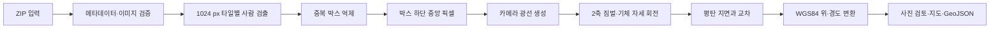

# UAV 영상 기반 사람 위치추정 시스템의 수학적 모델과 구현 검증

## 1. 목적과 구현 범위

이 프로그램은 UAV 영상과 촬영 시점 메타데이터를 입력받아 영상에서 사람을 검출하고, 각 사람의 영상 픽셀을 지상 위치로 투영한 뒤 전체 관측 분포를 웹 지도와 GeoJSON으로 출력한다. 기하 모델은 Kim et al. (2025)의 좌표계 변환, 핀홀 카메라 모델 및 광선-지면 교차식을 단일 프레임에 적용한다.

논문 전체를 재현하는 구현은 아니다. 논문의 능동 짐벌 제어, CSRT 추적, 동일 표적의 시간 연계, unicycle 운동 모델, EKF와 UKF는 구현하지 않는다. 따라서 출력점은 각 영상에서 독립적으로 계산한 **관측 위치**이며, 동일 인물의 궤적이나 필터링된 위치가 아니다.

## 2. 시스템 처리 흐름

코드 대응은 다음과 같다.

| 처리 단계 | 구현 위치 | 결과 |
|---|---|---|
| ZIP 및 영상 검증 | `uav_web/core.py: import_zip` | 프레임별 영상·상태 정보 |
| 사람 검출 | `uav_web/detector.py: Detector.detect` | 바운딩 박스와 신뢰도 |
| 위치 투영 | `uav_web/core.py: project` | 북·동 변위와 위·경도 |
| 검출점 수정·재계산 | `uav_web/server.py: /edit` | 검토된 관측점 |
| 웹 표시 및 내보내기 | `uav_web/index.html`, `geojson` | 지도, JSON, GeoJSON |

## 3. 좌표계와 입력 단위

항법 좌표계는 NED를 사용한다. 벡터의 세 성분은 각각 북쪽 (N), 동쪽 (E), 아래쪽 (D)이다. 카메라 광선도 기체 FRD와 축이 일치한다고 가정하여 첫 성분은 전방, 둘째는 우측, 셋째는 하방이다.

| 기호 | 의미 | 코드 입력 단위 |
|---|---|---|
| \(\phi_0,\lambda_0\) | UAV 위도·경도 | degree |
| \(h\) | UAV의 지면 기준 높이 | metre, AGL |
| \(\phi,\theta,\psi\) | 기체 roll·pitch·yaw | radian |
| \(\theta_g,\psi_g\) | 2축 짐벌 pitch·yaw | degree, 내부에서 radian 변환 |
| \(f_x,f_y,c_x,c_y\) | 카메라 내부 파라미터 | pixel |
| \(u,v\) | 사람의 지면 접점 픽셀 | pixel |

기본 카메라 값은 3840×2160 영상에 대해 \(f_x=f_y=2248\), \(c_x=1920\), \(c_y=1080\)이다. 이 값은 공칭값이므로 실제 카메라 보정 결과로 교체해야 정량적 정확도를 주장할 수 있다.

## 4. 사람 검출과 대표 픽셀

원본 4K 영상을 1024×1024 타일로 나누고 768 pixel 간격으로 이동하므로 인접 타일은 256 pixel 겹친다. Ultralytics YOLO11n의 COCO `person` 클래스만 검출하며, 기본 신뢰도 임계값은 0.25이다. 타일 중복 검출은 신뢰도 내림차순으로 정렬한 뒤 IoU 0.45 미만인 박스만 유지한다.

검출 박스 \((x_{min},y_{min},x_{max},y_{max})\)에서 지면 접점은

\[
u=\frac{x_{min}+x_{max}}{2},\qquad v=y_{max}
\]

로 둔다. 이는 사람의 발이 박스 하단 중앙에 있다는 근사이다. 앉은 사람, 가려진 사람, 그림자나 부정확한 박스에서는 편향이 생기므로 웹 화면에서 접점 픽셀을 수정할 수 있다.

## 5. 핀홀 카메라 광선

왜곡이 제거된 핀홀 카메라를 가정하면 픽셀의 정규화 좌표는

\[
x_n=\frac{u-c_x}{f_x},\qquad y_n=\frac{v-c_y}{f_y}
\]

이고 카메라 좌표계의 비정규화 광선은

\[
\mathbf r_G=\begin{bmatrix}1 & x_n & y_n\end{bmatrix}^{T}
\]

이다. 광선을 단위벡터로 정규화하지 않아도 이후 계산에서 성분비만 사용하므로 교차점은 동일하다.

## 6. 2축 짐벌과 기체 자세 변환

기체의 3-2-1 Euler 회전은

\[
\mathbf R_B^N=\mathbf R_z(\psi)\mathbf R_y(\theta)\mathbf R_x(\phi)
\]

이다. 2축 짐벌에는 roll 축이 없으므로 짐벌에서 기체로의 회전은

\[
\mathbf R_G^B=\mathbf R_z(\psi_g)\mathbf R_y(\theta_g)
\]

이다. 따라서 NED 좌표계에서 표적을 향하는 광선은

\[
\mathbf d_N=
\mathbf R_z(\psi)\mathbf R_y(\theta)\mathbf R_x(\phi)
\mathbf R_z(\psi_g)\mathbf R_y(\theta_g)
\mathbf r_G
=\begin{bmatrix}d_N&d_E&d_D\end{bmatrix}^{T}.
\]

행렬은 오른쪽 벡터부터 적용된다. 즉 카메라 광선에 짐벌 pitch, 짐벌 yaw, 기체 roll, pitch, yaw가 차례로 적용된다. 이 순서는 `core.py`의 행렬 곱과 일치한다. 입력 메타데이터의 각도가 이 좌표계와 부호 규약을 따른다는 전제가 필요하다.

## 7. 광선과 지면의 교차

UAV를 원점으로 놓고 지면이 수평이며 UAV 아래에서 \(D=h\)라고 가정한다. 광선 위 점은

\[
\mathbf p(\rho)=\rho\mathbf d_N
\]

이므로 하방 성분에서

\[
\rho=\frac{h}{d_D}
\]

를 얻는다. 지상점의 국소 변위는

\[
\Delta N=h\frac{d_N}{d_D},\qquad
\Delta E=h\frac{d_E}{d_D}.
\]

코드는 \(d_D\le 10^{-6}\)인 경우 광선이 전방 지면과 유효하게 교차하지 않는 것으로 처리한다. 현재 지형고도 모델은 없으며 모든 표적이 UAV의 AGL 기준 평면에 있다고 본다. 지면 표고차 \(\Delta h\)를 같은 수직 기준으로 얻는다면 식의 \(h\)를 \(h-\Delta h\)로 교체할 수 있다.

## 8. 북·동 변위의 위·경도 변환

WGS84 장반경 \(a=6378137\,\mathrm m\), 제1이심률 제곱 \(e^2=6.6943799901413165\times10^{-3}\)을 사용한다. UAV 위도 \(\phi_0\)에서 묘유선 및 자오선 곡률반경은

\[
R_N=\frac{a}{\sqrt{1-e^2\sin^2\phi_0}},\qquad
R_M=\frac{a(1-e^2)}{(1-e^2\sin^2\phi_0)^{3/2}}
\]

이고 최종 좌표는

\[
\phi_t=\phi_0+\operatorname{deg}\left(\frac{\Delta N}{R_M}\right),
\qquad
\lambda_t=\lambda_0+\operatorname{deg}\left(\frac{\Delta E}{R_N\cos\phi_0}\right)
\]

로 계산한다. 이는 짧은 거리의 국소 접평면 근사이다. 일반적인 UAV 촬영 거리에는 적합하지만 장거리 투영에는 ECEF 또는 측지선 직접해가 더 적절하다.

## 9. 입력 검증과 결과 관리

ZIP에는 `metadata.json`이 정확히 하나 있어야 하며 이미지 배열은 1~500장으로 제한된다. 전체 압축해제 크기, 파일 수, 이미지 크기, 경로 순회, 중복 경로, SHA-256, 영상 해상도를 검사한다. 잘못된 프레임은 오류로 남기고 나머지 프레임은 계속 처리한다.

자동 검출 후 사용자는 사람 접점을 추가·이동·삭제하고 프레임을 검토 완료로 표시할 수 있다. 수정할 때마다 좌표를 다시 계산한다. 결과의 사람 수는 여러 프레임에 나타난 **검출 관측 횟수**이므로 고유 인원 수와 같지 않다. GeoJSON의 각 점에는 프레임 번호, 관측 ID, 촬영 시각, 자동/수동 출처, 검토 상태와 접점 근사 여부가 기록된다.

## 10. 논문 대비 구현 검증 결과

| 항목 | 판정 | 근거와 의미 |
|---|---|---|
| 3-2-1 기체 회전 | 일치 | \(R_zR_yR_x\) 순서를 그대로 구현 |
| 2축 짐벌 회전 | 일치 | roll 없이 \(R_z(\psi_g)R_y(\theta_g)\) 사용 |
| 핀홀 광선 | 일치 | 내부 파라미터로 픽셀을 정규화 |
| 평탄 지면 교차 | 일치 | NED 하방 성분과 AGL의 비로 교차 계산 |
| 절대 위치 변환 | 타당 | WGS84 국소 곡률반경을 이용한 1차 근사 |
| 표적 검출기 | 개념만 대응 | 논문 Tiny-YOLO 대신 YOLO11n 사용 |
| 영상 추적 | 미구현 | 프레임 사이 동일 표적을 연결하지 않음 |
| 짐벌 제어 | 미구현 | 저장된 각도를 사용하며 제어 명령을 만들지 않음 |
| EKF/UKF | 미구현 | 관측 잡음 저감이나 폐색 구간 예측 없음 |
| 지형·왜곡 보정 | 미구현 | 평면 지면과 이상적 핀홀 카메라 가정 |

결론적으로 현재 코드는 논문의 **단일 영상 기하 위치측정 부분**을 2축 짐벌 조건에 맞게 구현했다. 그러나 논문이 제시한 추적·필터링 통합 시스템 전체를 재현한 것은 아니다. 실제 위치 정확도를 평가하려면 보정된 카메라 내부 파라미터, 렌즈 왜곡 계수, 카메라-짐벌 보어사이트, 센서 시간 동기, 지형 표고와 RTK 등 독립된 기준 좌표가 필요하다.

## 11. 오차 요인과 정확도 검증 방법

주요 오차원은 픽셀 접점 오차, 초점거리와 주점 오차, 자세 및 짐벌 각도 오차, AGL 오차, 평탄 지면 가정, 보어사이트 오차와 센서 시각 불일치이다. 특히 광선이 지면과 얕은 각도로 만날수록 \(d_D\)가 작아져 위치 오차가 크게 증폭된다.

정량 검증은 위치를 알고 있는 지상 기준점 또는 RTK로 측정한 사람 위치를 사용해야 한다. 각 관측에 대해

\[
e_i=\sqrt{(N_i-N_i^{ref})^2+(E_i-E_i^{ref})^2}
\]

를 계산하고 평균 오차, 중앙값, RMSE, 95백분위수와 최대 오차를 보고한다. 거리, 짐벌 하향각, 영상 영역, 비행 고도별로 오차를 나누어 제시하면 모델의 적용 범위를 판단할 수 있다.

## 참고문헌

Kim, J., Kim, Y., Kim, S., Cho, H., & Jung, D. (2025). Vision-Based Geolocation of Moving Ground Targets Using Kalman Filtering with a Gimbal Camera on Board a UAV. *Aerospace, 12*(12), 1065. https://doi.org/10.3390/aerospace12121065
